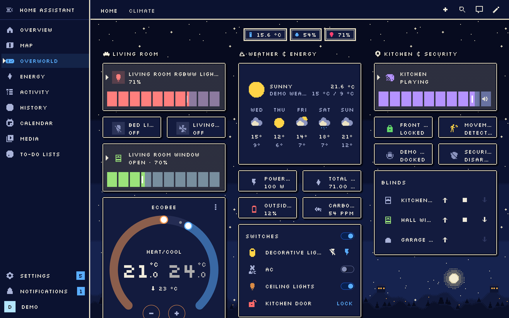
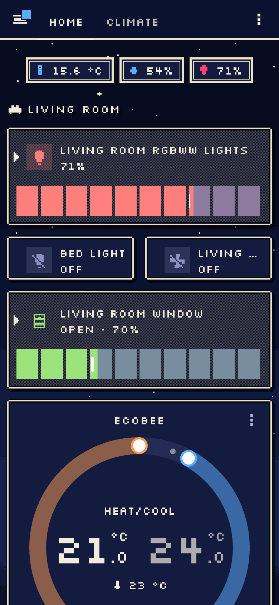
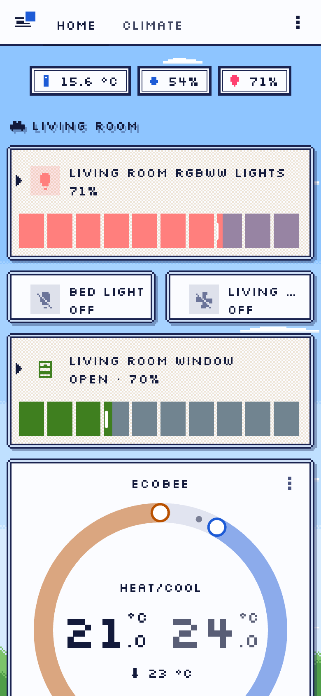
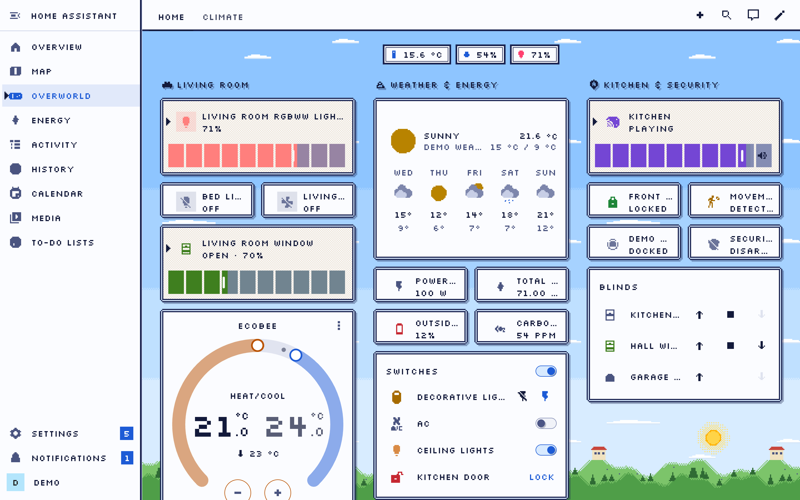
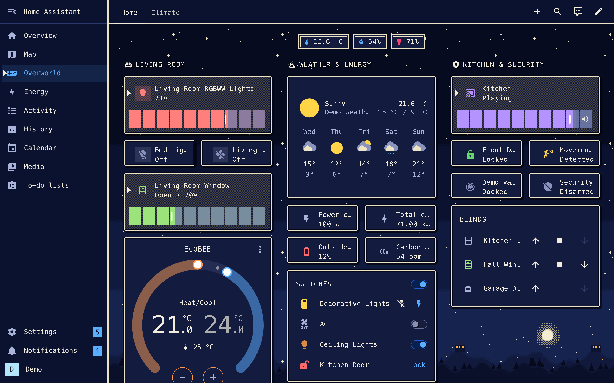
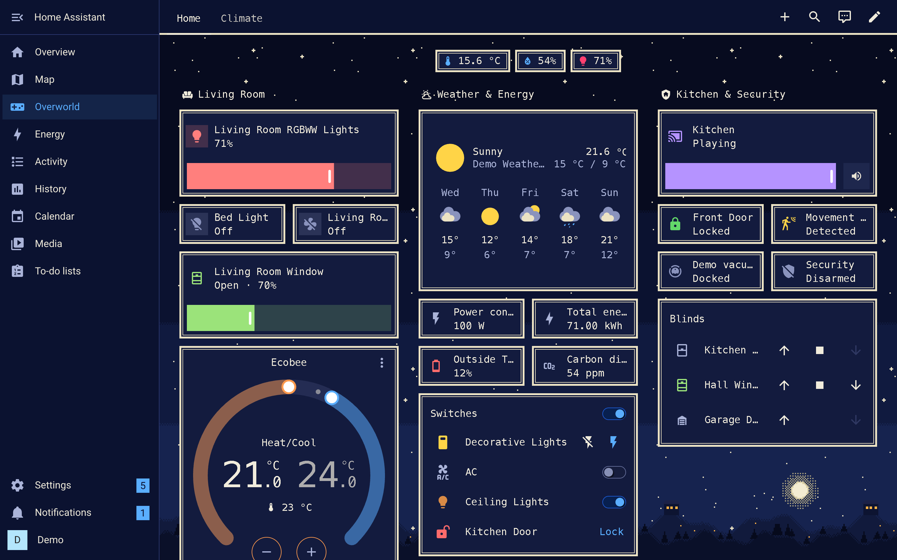
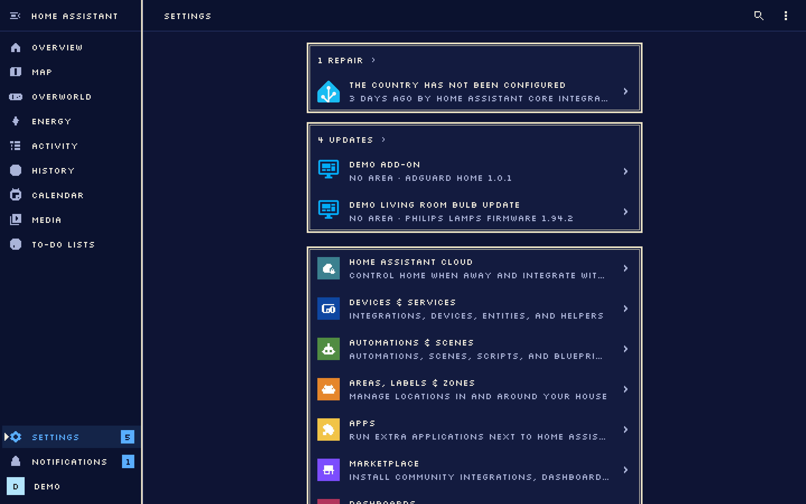
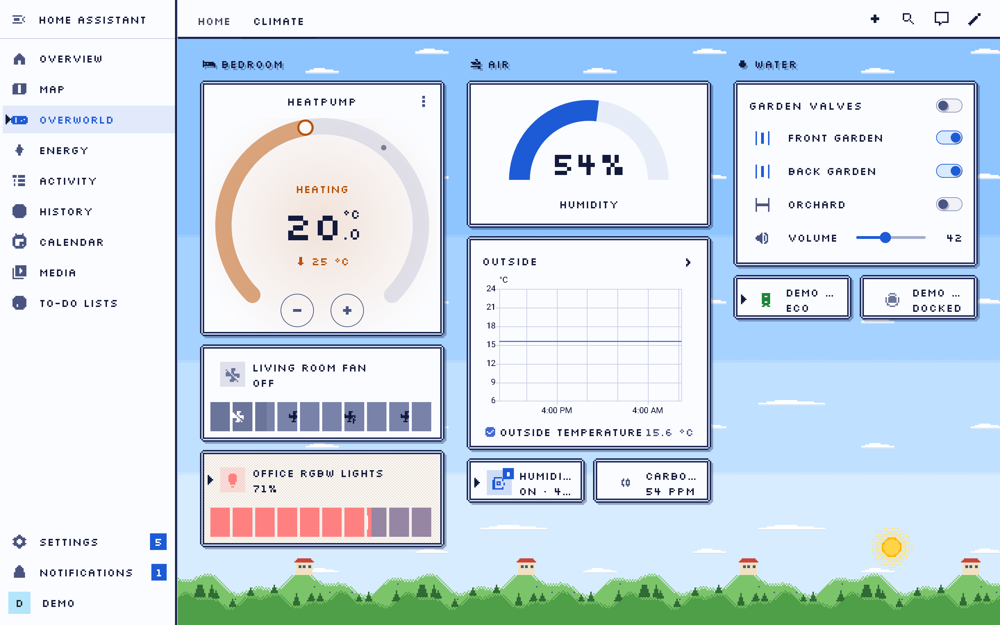

# Overworld

[](https://my.home-assistant.io/redirect/marketplace_repository/?owner=wsclx&repository=overworld-theme&category=theme)

A pixel-art theme for Home Assistant: your dashboard sits in a small pixel landscape, cards are windows with stepped corners and hard pixel shadows, and with the companion module every icon and every letter is drawn on the same pixel grid. Dark and light mode in one theme.



| Dark | Light |
|---|---|
|  |  |



## What you get

- **A pixel landscape behind your dashboards.** Night: four bands of sky with dithered steps, stars, a moon with a dithered halo, hills, pine trees and houses with lit windows. Day: a sun, pixel clouds and green hills. All drawn as small inline images, nothing is downloaded.
- **One pixel size.** Frames, shadows, the landscape, the cursor and (with the module) icons and text all use the same 2 px art pixel, so nothing looks mixed.
- **Windows with stepped corners** and a hard pixel shadow that follows the steps (card-mod).
- **Switched-on tiles** get a dithered fill and a pixel cursor in front of the icon (card-mod).
- **Block bars** for sliders in tiles you choose (card-mod, see below).
- **A small console palette** in dark and light; text meets WCAG contrast (4.5:1) in both modes.

## Three levels

The theme works on its own and gets more pixel with each optional part:

| Installed | Looks like |
|---|---|
| Theme only | Landscape, colours, square corners, frames with a straight edge, system monospace font |
| Theme + [card-mod](https://github.com/thomasloven/lovelace-card-mod) 4.x | Stepped window corners, pixel shadows, dithered active tiles, pixel cursor, block bars |
| Theme + card-mod + [Overworld Pixels](https://github.com/wsclx/overworld-pixels) | Icons redrawn as pixel art, all text in a pixel font |





Settings and other views use the same windows:

| Settings | Climate view |
|---|---|
|  |  |

## Requirements

- Home Assistant with themes enabled. Tested with Home Assistant 2026.11.2 (November 2026).
- Optional: [card-mod](https://github.com/thomasloven/lovelace-card-mod) 4.x. Tested with card-mod 4.2.1.
- Optional: [Overworld Pixels](https://github.com/wsclx/overworld-pixels) 1.x for pixel icons and the pixel font.

## Installation

### Marketplace (HACS)

1. Open **Settings → Marketplace** (or HACS on older versions).
2. Search for **Overworld** and download it.
3. Reload themes: **Developer tools → Actions → `frontend.reload_themes`**.
4. Optional: download **Overworld Pixels** from the Marketplace as well (category Dashboard).

### Manual

1. Copy `themes/overworld.yaml` into the `themes` folder of your configuration.
2. Make sure your `configuration.yaml` loads that folder:

   ```yaml
   frontend:
     themes: !include_dir_merge_named themes
   ```

3. Restart Home Assistant or run `frontend.reload_themes`.

## Use the theme

Open your **profile**, choose **Overworld** under *Theme*, and pick *Auto*, *Light* or *Dark*.

## Optional: card-mod and the module everywhere

Both card-mod and Overworld Pixels work best when they are loaded as frontend modules, so they also apply to settings pages and not only after a dashboard has been opened:

```yaml
frontend:
  themes: !include_dir_merge_named themes
  extra_module_url:
    - /local/community/lovelace-card-mod/card-mod.js
    - /local/community/overworld-pixels/overworld-pixels.js
```

Adjust the paths to where both are installed on your system.

- The pixel cursor and the dithered fill appear on tile cards of these domains when they are on or open: `light`, `switch`, `fan`, `media_player`, `climate`, `input_boolean`, `humidifier`, `water_heater`, `vacuum`, `remote`, `siren`, `automation`, `script`, `cover`. Sensors are left out on purpose: the tile card marks every entity with a value as active.
- Tile icons move 10 px to the right to make room for the cursor.
- The more-info dialog and the sidebar use the theme font as well.

### Block bars

Block bars are switched on per tile, because the same mask would cut button rows (playback controls, colour favourites, fan presets) apart. Give a tile the class `overworld-blocks` and put the slider as its **first** feature:

```yaml
type: tile
entity: light.living_room
features_position: bottom
features:
  - type: light-brightness
card_mod:
  class: overworld-blocks
```

## Customise

| Variable | Used for |
|---|---|
| `overworld-pixels` | `"on"` switches the Overworld Pixels module on for this theme; anything else leaves icons and fonts alone |
| `overworld-pixel-size` | Size of one art pixel in CSS pixels for the module (default 2) |
| `overworld-line`, `overworld-window` | Frame colour and window fill |
| `overworld-frame-image` | The stepped frame as a 7×7 inline image, used as `border-image` (card-mod) |
| `overworld-shadow` | Hard pixel shadow under windows (card-mod) |
| `overworld-dither` | Colour of the dithered fill of active tiles (card-mod) |
| `overworld-cursor` | Colour of the pixel cursor (card-mod) |
| `lovelace-background` | The landscape: hills band, moon or sun, stars or clouds, and four sky bands |
| `primary-color`, `ha-color-primary-*` | Action colour and the blue scale the frontend uses for buttons and switches |

## Known limits

- Toggle switches, the round thermostat dial, the plus and minus buttons and charts keep their smooth shapes: the frontend draws them itself.
- The module redraws icons automatically. Icons with very fine inner lines (for example the history chart) lose detail on a 12×12 grid.
- The pixel font is wide. Long names in narrow tiles are shortened earlier than with other themes.
- Windows have a thicker frame, so tile rows are 64 px high instead of 56 px.
- Home Assistant does not guarantee theme variables between releases. The card-mod rules and the module target internal elements of the frontend and can break with an update; the theme itself keeps working. If something looks off, please open an issue with your version.

## Contributing

Issues and pull requests are welcome. Please include your Home Assistant version, card-mod and Overworld Pixels versions (if used), browser and a screenshot.

## License

[MIT](LICENSE)

The look is inspired by 8-bit games and computers in general, not by any particular game. This is a community project. It is not affiliated with or endorsed by Home Assistant or the Open Home Foundation.
